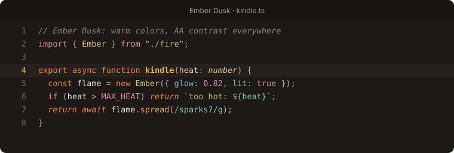
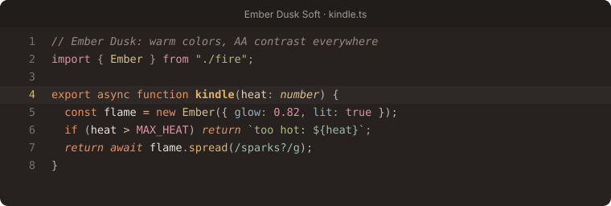
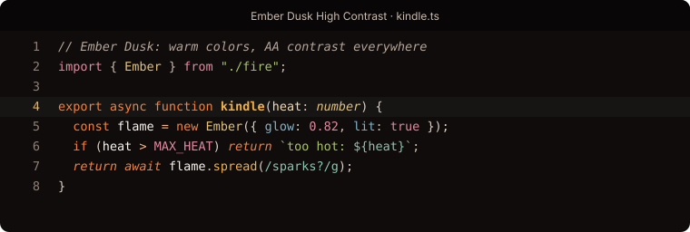
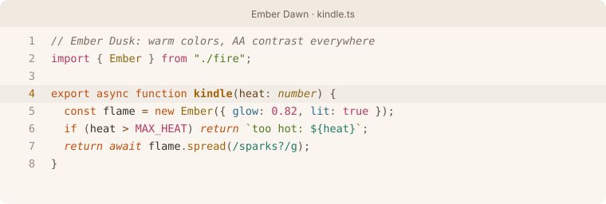

# Ember Dusk

A warm, carefully tuned theme family for [Zed](https://zed.dev): charcoal backgrounds, ember orange and amber accents, and a matching light theme.

| Ember Dusk | Ember Dusk Deep |
| --- | --- |
|  |  |
| **Ember Dusk Soft** | **Ember Dusk High Contrast** |
|  |  |
| **Ember Dawn** | |
|  | |

## Variants

- **Ember Dusk**: the default warm dark theme
- **Ember Dusk Deep**: near black, for OLED screens and dark rooms
- **Ember Dusk Soft**: lower contrast, for long sessions
- **Ember Dusk High Contrast**: WCAG AAA (7:1) on every token, for low vision or bright rooms
- **Ember Dawn**: warm paper light theme

## Why Ember Dusk

- **Readable everywhere.** Every syntax token in every variant meets WCAG AA contrast (4.5:1) against the editor background, comments included. Many popular themes let comments and punctuation drop to 2–3:1. The High Contrast variant goes further, to AAA (7:1).
- **Color-blind safe diffs.** Added, deleted and modified colors are checked under simulated protanopia, deuteranopia and tritanopia, and tuned so they never blur together. Red and green alone don't carry the meaning.
- **Complete.** Covers all 142 properties in Zed's theme schema, plus version-control, search and scrollbar keys, so no part of the UI falls back to default colors.
- **Detailed highlighting.** 76 syntax scopes, including function calls vs. definitions, builtins, members, imports, decorators, TODO/FIXME comments, Markdown and diffs.
- **Full terminal palette.** Normal, bright and dim ANSI colors.
- **8 collaborator colors** for multiplayer cursors and selections.

## Install

In Zed: open **Extensions** (`cmd-shift-x`), search for **Ember Dusk**, and click Install. Then open the theme selector (`cmd-k cmd-t`).

## Development

All colors are generated from a small palette in `scripts/build.py`, which automatically raises contrast to the required minimum and tunes the git and diagnostic colors for color-blind readability:

```sh
python3 scripts/build.py
```

To try local changes, run `zed: install dev extension` in Zed and select this folder.

## License

MIT
